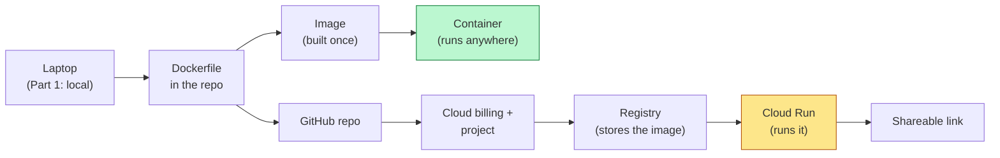
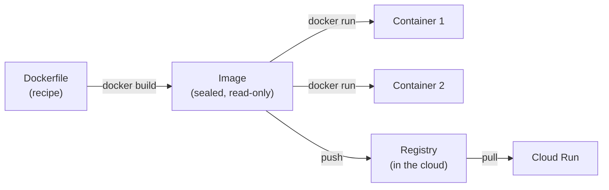
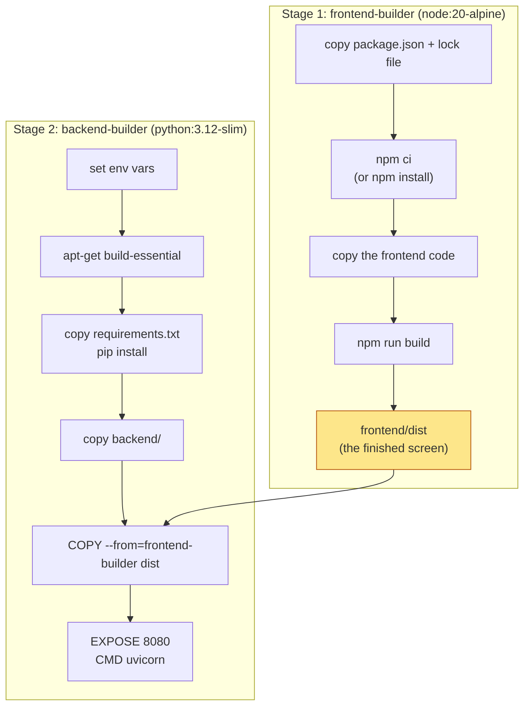
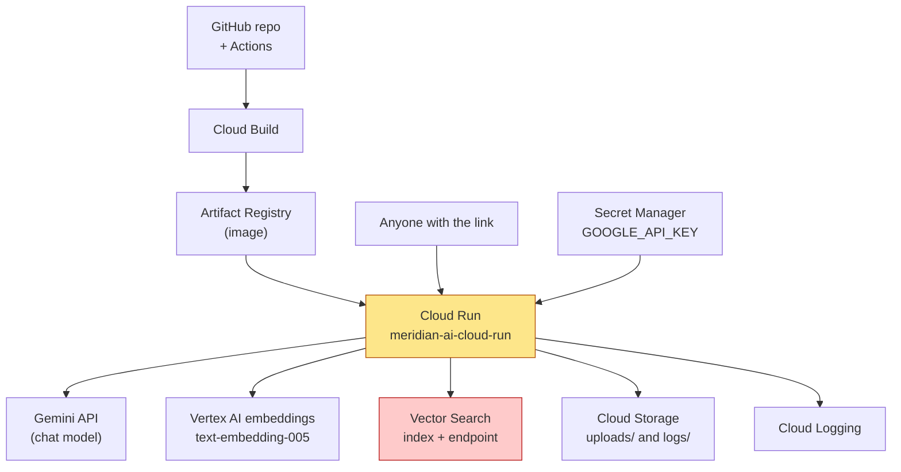
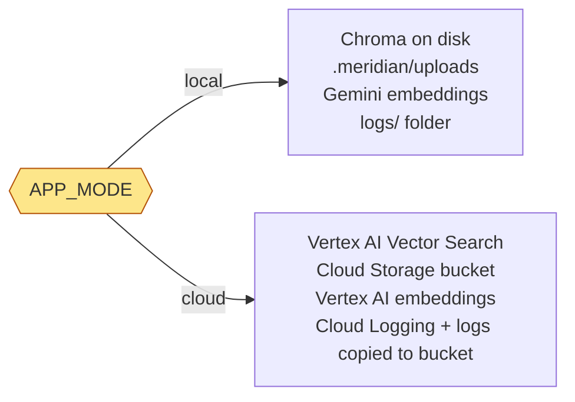
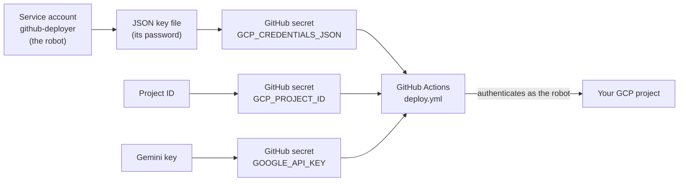
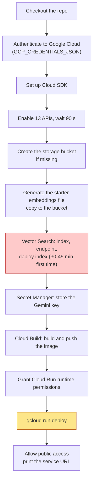

# 🐳 Meridian AI — Docker, Google Cloud and the Road to Cloud Run: Part 2 Begins
### 📋 Agentic AI 3.0 Specialization | Krish Naik Academy

**🎙️ Mentor:** Mayank Aggarwal
**⏱️ Duration:** ~3 hours 50 minutes (recording) | **📅 Session:** Sunday, 25 October 2026
**🧩 Project:** Meridian AI, Part 2 (deployment): containerize the app, understand every Google Cloud piece it needs, and see how GitHub Actions will provision and deploy it

---

## 📌 Session Summary

Topics covered today:

- Recap of Part 1 and the plan for Part 2 (deployment)
- Why Docker: "it works on my machine"
- The four words: Dockerfile, image, container, registry
- The multi-stage `Dockerfile`, line by line (including `package.json` vs `package-lock.json`)
- `.dockerignore`: what stays out of the image
- Building the image and Docker's layer cache
- Running the container: `docker run`, `ps`, `logs`, health check, `exec`, `stop`, `rm`
- Temporary container disk, volumes, and common Docker errors
- Google Cloud orientation: free trial, project, console, Cloud Shell
- The services Meridian uses: Cloud Run, Cloud Build, Artifact Registry, Cloud Storage, Vertex AI embeddings, Vector Search, Secret Manager, IAM, Cloud Logging
- Local vs cloud: one `APP_MODE` switch
- Costs: what keeps billing, budgets and spend caps
- Preparing the cloud: Gemini key, account, project, billing, `gcloud`
- The robot account, its JSON key and the three GitHub secrets
- First look at the GitHub Actions workflow `deploy.yml` (the live deployment is next session)
- Live Q&A

---
## References
- https://github.com/mayank953/meridian-ai-learner
- https://meridian-ai-course.netlify.app/module-6#12
- https://helpme.tebra.com/Tebra_PM/12_API_and_Integration/01_Get_Started_with_Tebra_API_Integration/Tebra_API_Integration_User_Guide

---

## 📰 Quick Updates

- **Part 2 slides.** The Part 2 deck is an interactive app rather than a PowerPoint, so it is heavy to share. Mayank said he would publish it "today or tomorrow" (he rates it among the best decks the team has made). He also mentioned that Netlify has started charging him for the site, so the link may move.
- **The GitHub repo is the source of truth for deployment.** Many students' local copies have extra or missing files from the learning phase, so for Docker and GCP everyone should work from a fresh clone (or `git pull` in their `meridian-reference` folder) of `mayank953/meridian-ai-learner`. The Actions tab of his repo showed one green run and one failed run, a reminder that deployments fail for boring reasons and that using one known-good copy keeps that to a minimum.
- **Holiday:** **7–8 November** is off.
- **Next project:** he plans to hand it out around **27–28 November**. It will be a LangChain + GCP project that goes deeper (he plans **Grafana and Prometheus**). A LangGraph project already exists, but **LangGraph is taught first**.
- **Possible future class:** a "harness engineering" class, where the group builds a small Claude-Code-style tool. He is not sure it will fit this batch. Someone asked about "Code Mode" and he said he had not looked into it yet.
- **Not covered here:** Git and version control will not be taught, and this is not a Docker crash course (he has recorded part of one and will release it). From now on, later slides assume Docker is understood.
- **Why so slow on one project.** He deliberately spends 2–3 weeks on a project so that everyone ends with at least one project they can explain in depth in an interview. Ticking off more frameworks, he said, will not help as much.
- **Everyone needs a GCP account** (with billing linked) before the deployment session.

---

## 🧭 Where We Stand

Part 1 built and ran the whole app on a laptop. Part 2 has two jobs: **(a)** containerize it with Docker and run it locally, and **(b)** push it to GCP, provision the resources it needs, and let a GitHub Actions workflow deploy it. Today covered all of (a) and the *understanding* half of (b); the live provisioning and deployment run is left for the next session.



Mayank's reason for this order: the cloud needs the same thing Docker gives you, an app that does not depend on the quirks of one machine. For the cloud he used GCP, but stressed that the ideas carry over to AWS and Azure.

---

## 🐳 Why Docker: "It Works on My Machine"

Mayank's framing was the classic one. You write a great project and it runs because your laptop has the right Python, the right libraries, the right Node, the right environment variables. You hand it to a friend (or to a testing team) and it fails, because their machine has a different OS version, an older Python, or a library installed in a different order. This is what Docker was built to end.

He used two pictures:

- **The instant-noodle cup.** Give people raw noodles and they will each make a different dish (extra water, masala first, butter). Put everything in a cup with a fill line and the instructions are baked in, so everyone gets the same taste.
- **The whale and the shipping containers.** Whatever is inside each container, the ship carries it the same way.

Docker's version of "the fill line" is a **text file of exact steps**: install this, copy that, start with this command. Follow the steps anywhere and you get the same running app.

| Word | What it is | Meridian example |
|---|---|---|
| **Dockerfile** | A text file in the project listing, step by step, how to build the box (about 40 lines here) | `Dockerfile` in the repo root |
| **Image** | The finished, read-only package: the OS layer, the libraries, your code | `meridian-ai`, about **1.8 GB** on disk |
| **Container** | A running copy of an image, with its own **temporary** disk. Many containers can run from one image | The `meridian` container on port 8080 |
| **Registry** | A shelf of images in the cloud. Cloud Run pulls the image from here when it starts a copy | Google's registry (covered later) |



A few clarifications from the chat:

- **Docker Desktop is free**, and installing it also gives you the Docker command-line tool. A GUI and the CLI do the same job.
- **"Why not just use `uv` or a virtual environment?"** Those isolate Python packages, but they still depend on what the host already has: the Python version, and OS-level libraries. Docker pins the whole stack, not just the packages.
- A container is **not** a full virtual machine; it runs on the host using the host's resources.
- If the code or dependencies change, the image has to be **rebuilt**.

---

## 📜 The Dockerfile, Line by Line

The repo's `Dockerfile` is a **multi-stage build**: two `FROM` blocks, where the second stage starts clean and only takes what it needs from the first.



Here is the real file from the repo:

```dockerfile
FROM node:20-alpine AS frontend-builder
WORKDIR /app/frontend

COPY frontend/package.json frontend/package-lock.json* ./
# Use npm ci if package-lock is present, else install
RUN if [ -f package-lock.json ]; then npm ci; else npm install; fi

COPY frontend/ ./
RUN npm run build


FROM python:3.12-slim AS backend-builder
WORKDIR /app

# Set environment variables for Python
ENV PYTHONDONTWRITEBYTECODE=1
ENV PYTHONUNBUFFERED=1

# Install system dependencies if required by some Python packages
RUN apt-get update && apt-get install -y --no-install-recommends \
    build-essential \
    && rm -rf /var/lib/apt/lists/*

COPY requirements.txt .
RUN pip install --no-cache-dir -r requirements.txt

# Copy backend application code
COPY backend/ ./backend/

# Copy environment variables and credentials (Uncomment during local development)
# COPY .env ./
# COPY credentials/ ./credentials/

# Copy built frontend static files from the frontend-builder stage
COPY --from=frontend-builder /app/frontend/dist /app/frontend/dist

# Expose the single port Cloud Run / local test will use
EXPOSE 8080

# Start the application using Uvicorn
# JSON form + "sh -c" keeps ${PORT} expansion; "exec" makes uvicorn PID 1 so it receives SIGTERM
CMD ["sh", "-c", "exec uvicorn api.main:app --app-dir backend --host 0.0.0.0 --port ${PORT:-8080}"]
```

### Stage 1: build the screen

- `FROM node:20-alpine AS frontend-builder` starts from a ready-made image that has Node 20 on **Alpine**, a small, lightweight Linux distribution. In effect you are downloading a tiny Linux into the build. `AS frontend-builder` gives the stage a name that stage 2 will refer to.
- `WORKDIR /app/frontend` sets the folder inside the image where the next commands run.
- **Copy `package.json` and the lock file first, then install.** Docker caches each step, so if only your code changes later, the slow install step is reused. It is the same reason you install an operating system before copying your games onto it. Mayank also noted that if you copied everything first, any code edit would invalidate the install cache.
- `npm ci` installs **exactly** what the lock file says; if there is no lock file, it falls back to `npm install`.
- Then the full frontend is copied and `npm run build` produces `frontend/dist`, the finished website.

> **A small npm lesson that came up.** In `package.json` a version such as `^1.3.7` means "any compatible minor or patch update, up to but not including 2.0.0". `package-lock.json` then records the exact version actually installed. Mayank compared this to `requirements.txt` plus `uv.lock` in Python (the idea was borrowed from Node). He copies **both** files because `package.json` is the main file you share, and the lock file may need regenerating when a library changes.

### Stage 2: build the backend and assemble the app

- `python:3.12-slim` is a **brand new stage**; nothing from stage 1 comes with it, which is why Node is not in the final image and the image stays smaller.
- `PYTHONDONTWRITEBYTECODE=1` stops `.pyc` files from being written, and `PYTHONUNBUFFERED=1` makes logs appear in `docker logs` immediately instead of waiting in a buffer.
- `apt-get install build-essential` adds OS tools some Python packages need while installing; the `rm -rf` afterwards trims the leftovers.
- `requirements.txt` is copied and installed **before** the code, and `backend/` is copied **last**, so code edits rebuild quickly.
- `COPY --from=frontend-builder ...` is "the bridge between stages": it takes only the built `dist` folder.
- `EXPOSE 8080` documents the port (publishing it is done with `-p` when you run).
- The `CMD` starts Uvicorn. `${PORT:-8080}` means "use the `PORT` the platform gives you, else 8080", which is how Cloud Run tells the app which port to listen on. Wrapping it in `sh -c` is what lets `${PORT}` expand, and `exec` makes Uvicorn the main process so it receives shutdown signals.
- The two commented lines (`COPY .env`, `COPY credentials/`) are for local experiments only. In the cloud the keys come from GCP and GitHub, so they are never baked into the image.

The result is **one image, one container, one port**: the backend serves the built front end, which is the "single server" mode from last session. Splitting front end and back end into separate containers is possible, but normally you make one image per project.

Asked whether you must hand-write a Dockerfile each time, Mayank was blunt: these days an AI assistant writes it for you, but you must be able to read it.

---

## 🚫 `.dockerignore`: What Stays Out of the Box

Anything not needed at runtime, or not safe to ship, is excluded. The real file (trimmed to the parts he went through):

```text
# Environment & credentials (injected via Cloud Run env vars / Secret Manager)
.env
.env.*
credentials/

# Git
.git/
.github/
.gitignore

# Docs & misc
README.md
logs/
*.log
.meridian/

# Node (frontend build happens inside Docker)
frontend/node_modules/
frontend/dist/

# Python bytecode
__pycache__/
*.py[codz]
```

| Left out | Why |
|---|---|
| `.env`, `credentials/` | "Handed over at start, never packed inside." A secret baked into an image can leak with the image |
| `.git`, `.github`, editor folders | Not needed to run |
| Docs and logs | Logs are created fresh while the app runs |
| `frontend/node_modules`, `frontend/dist` | Very heavy; the build **inside** Docker recreates what is needed |
| `__pycache__` and `.pyc` | Created at runtime; stale Windows-built ones can break Linux containers |

For his first local test Mayank temporarily let `.env` through (he commented it out of the ignore list) so the container would start with his key. He repeated that this is for local testing only: **do not copy `.env` into an image unless you are happy to share the keys with everyone who gets the image.** The recommended route, which he used for the real run, is to hand the file over at startup with `--env-file`.

---

## 🔨 Building the Image

The commands live in the repo's `Docker_commands.txt`:

```bash
git clone https://github.com/mayank953/meridian-ai-learner.git && cd meridian-ai-learner
cp .env.example .env     # then add your GOOGLE_API_KEY, no quote marks
docker build -t meridian-ai .
docker images meridian-ai
```

- `.env.example` exists because real keys are never shared; you copy it to `.env` and add your own `GOOGLE_API_KEY` (no quote marks).
- `docker build -t meridian-ai .` means "build an image named `meridian-ai` from the Dockerfile in the current folder". Docker finds the file called `Dockerfile` by itself.
- `docker images meridian-ai` lists it: about **1.79 GB**.
- **Timing and caching.** A first build takes roughly 4–7 minutes depending on internet speed, mostly downloads. Run it again and, because every step is cached, it takes about **3 seconds**. Mayank then deleted the image in Docker Desktop and rebuilt it live: about 7–8 seconds, because the downloaded layers were still cached on his machine, and 2–3 seconds on the next rebuild.

If you already have a copy of the repo from the earlier sessions, you do **not** need to clone again; run `git pull` in your reference folder. The clone line is for starting from scratch. (This clone-vs-pull point took several minutes of class time, and he asked people to revise the basics before sessions.)

---

## ▶️ Running the Container

```bash
docker run -d --name meridian -p 8080:8080 --env-file .env meridian-ai
docker ps
docker logs meridian
curl http://localhost:8080/api/health
```

| Part | Meaning |
|---|---|
| `-d` | Run in the background (detached) |
| `--name meridian` | Name the container, so later commands can say `meridian` |
| `-p 8080:8080` | Publish container port 8080 on your machine's port 8080 |
| `--env-file .env` | Hand the variables to the container when it starts, without baking them into the image |

What Mayank demonstrated, in order:

1. **`docker ps`** shows the container as running (it also turns green in Docker Desktop).
2. **`docker logs meridian`** prints the backend's output, including the health check being hit and, after an upload, "how many chunks were created".
3. **`curl .../api/health`** returns the health response he built in Part 1.
4. He opened **`localhost:8080`**: the full app was running from the container. He dragged a sample document in and the ingestion completed. Notably, **no `.meridian/chroma` folder appeared on his laptop**, because the app was writing inside the container.
5. He looked **inside the container** with `docker exec`, ran `ls -a` and saw the same layout as the repo (`backend`, `frontend`, `logs`, `requirements.txt`) on a Linux filesystem. A hidden folder is where the data lives, so plain `ls -ltr` will not show it (he first expected it to and then corrected himself: you need `-a`). He also printed the container's environment **names only, never the values**, to show the variables arrived.
6. **`docker stop meridian`** stops it in about a second, and **`docker rm meridian`** removes it. The image stays, so you can `docker run` it again.

> **Two terms that trip people up.** `docker run` creates a container *from* an image (and starts it). The logs shown are the **backend's** logs, since that is the only server running; the built front end is served by the same process.

---

## 💾 The Container's Disk Is Temporary

This is the point Mayank cared most about before moving to the cloud. A file written inside a running container lives on a temporary disk. When the container is removed, **the uploads, the vector database, the logs, everything it created are gone**.

- **Docker's answer on a laptop is a volume**: a folder Docker keeps *outside* any container, which you mount into a new container so the old files come back. The repo's README uses this to keep the local vector DB and uploads between restarts:

```bash
docker run -p 8080:8080 --env-file .env -v "$(pwd)/.meridian:/app/.meridian" meridian-ai
```

- **The cloud's answer is to move data out of the container for good.** That is the whole reason Meridian has two modes (see below): uploaded PDFs go to **Cloud Storage**, vectors go to **Vertex AI Vector Search**, and the logs are copied to storage when the app shuts down. Nothing worth keeping lives in the container.

He also shared a short troubleshooting list from the slides:

| You see | Likely reason |
|---|---|
| Docker commands fail | **Docker Desktop is not running** |
| **503, Google key empty** | `GOOGLE_API_KEY` is missing from `.env` |
| Port already allocated, or app unreachable | Something else uses 8080; map a different host port |
| API key not valid | Generate a fresh key in AI Studio |
| Image builds on a Mac but fails on Cloud Run | An **ARM64** build (Apple Silicon, and some Windows laptops now) running on Cloud Run's x86 machines; build explicitly for x86 (Docker's `--platform` option) |

His summary of the Docker half: the same image runs on any computer with Docker, including Google's.

---

## ☁️ Google Cloud Orientation

Mayank signed in on a second Google account to show the console, as a fresh user would see it.

**The free trial.** New Google Cloud customers get a trial of **$300 credit for 90 days**. Per his experience, outside India it asks for nothing up front; in India it asks for a ₹1,000 prepayment (he wasn't sure it is refundable). A trial can be activated only once per account; if you have used one, or are not eligible for your region, you will have to pay. The repo's docs add that a **card is required** and the hold is not a charge, and that you are not billed automatically when the trial ends. He deliberately started with a trial account himself so he would hit the same problems students might.

**Create a project.** Name it (he used *Meridian AI*), attach a billing account, choose organization and parent. Then **select the project** in the picker. Mayank repeated this: always check which project is active.

**A tour of the console:**

| Piece | What it is for |
|---|---|
| Navigation menu (☰) | All Google Cloud services |
| **Project picker** | Switch project; shows the **project ID**, which you must save because the deployment needs it |
| Search box | Jump to any service |
| **Cloud Shell** | A terminal that runs in Google's cloud, already authorized for your project; an alternative to installing `gcloud` yourself |
| Notifications, free-trial banner, pinned products | Housekeeping |
| Project info card | Name, ID and number |

---

## 🧩 The Services Meridian Uses

Mayank went through each service with the same four questions: what is it, why this one (and what is the AWS/Azure equivalent), how does it scale, and where do you find it. All the creation will be done by GitHub Actions, not by clicking.

| Service | What it does for Meridian | AWS / Azure counterpart (he named some; the rest are the standard equivalents) |
|---|---|---|
| **Cloud Run** | Runs the Docker image and gives an HTTPS address | Lambda-like convenience for containers (AWS App Runner / Fargate, Azure Container Apps) |
| **Cloud Build** | Builds the image from the repo's `Dockerfile` in the cloud | CodeBuild |
| **Artifact Registry** | Stores the built images ("a shelf for container images") | ECR / ACR |
| **Cloud Storage (GCS)** | Buckets for uploaded PDFs, the logs, and index staging data | S3 / Azure Blob Storage |
| **Vertex AI embeddings** | Turns text into numbers; model **`text-embedding-005`**, **768 dimensions** | Bedrock embeddings / Azure AI Foundry |
| **Vertex AI Vector Search** | The managed vector database: stores vectors and finds the closest ones | OpenSearch / Azure AI Search |
| **Gemini API** (AI Studio key) | The chat model "brain" | Bedrock / Foundry models |
| **Secret Manager** | Safe store for keys and passwords | Secrets Manager / Key Vault |
| **IAM + service accounts** | Who or what is allowed to do what | IAM / Entra ID |
| **Cloud Logging** | Collects the app's JSON logs; searchable in Log Explorer | CloudWatch / Azure Monitor Logs |
| **Monitoring, Trace, BigQuery** | Switched on but **not used** yet | CloudWatch, X-Ray, Redshift/Synapse |



Some detail on the main pieces:

- **Cloud Run** is a managed place to run a container: you hand over an image and get an HTTP address. More visitors lead to more copies; when nobody visits it scales back down, so there is no server to look after. Mayank compared it to Lambda. In Meridian the settings are the service name, region, image, a maximum of **3 copies**, `APP_MODE=cloud` and the Gemini key. It is the "heavy lifting" trio with Cloud Build and Artifact Registry.
- **Cloud Storage** holds buckets (globally unique names), objects (files) and prefixes (like folders). Meridian keeps each uploaded PDF under `uploads/` and, when the container shuts down, copies its log files under `logs/`. Mayank showed the cost calculator in the create-bucket page: storage is billed per GB-month at a very small rate.
- **Embeddings and Vector Search.** Chroma is gone in the cloud. The embedding model turns each chunk into 768 numbers (similar meaning gives close numbers); **Vector Search** stores them and finds the nearest ones. The slide and the console define three terms: an **index** (the stored vectors, organised for fast search), an **endpoint** (where queries go) and a **deployed index** (the index running on a machine at that endpoint). The create form asks for dimensions, algorithm, approximate neighbour count, distance measure, update method and shard size, which are exactly the fields the workflow fills in from code (see below). The index updates automatically with the streaming update method.
- **Gemini API** stays as the language model. This time it is *not* used for embeddings, since those come from Vertex AI. The key is the same one from AI Studio.
- **Secret Manager** holds the Gemini key. The key is supplied once through a GitHub secret and the workflow writes it into Secret Manager, so it exists in both places by design (see Q&A). He read the pricing page as free up to about 10,000 operations, then a few rupees per 10,000.
- **IAM** (Identity and Access Management) is how Google knows that *someone authorized* is calling it, which matters because GitHub, not a person, will be doing the deploying.
- **APIs and services.** In a new project every Google service is **off** until you enable it. The workflow switches on **13 APIs** with one `gcloud services enable` command and then waits 90 seconds. A proper developer, he said, does this in code instead of clicking through the UI.
- **Cloud Logging** gets the app's one-JSON-line-per-event output from the container automatically and lets you search by field in Log Explorer, set alerts, and so on. That is why it beats just reading `docker logs`.
- **Monitoring, Cloud Trace and BigQuery** are enabled to show what exists, but nothing in the code uses them; they cost nothing by themselves. He suggested checking whether a service is needed and what it costs before enabling it, and noted they become useful when the projects get more complex (the next project).

> **Good to know (a few tightened details).**
> - Cloud Run is Google's **serverless** container platform: it scales to zero when idle (so the first request after a quiet period is a little slower, a "cold start"). Mayank said in Q&A that it was not serverless; the repo's own docs describe the scale-to-zero behaviour.
> - Azure's file/object store is **Blob Storage** (he said "block storage"), and the Kubernetes service on Google is **GKE**.
> - He mentioned Cloud Build taking "40–45 minutes". The long wait is actually the **Vector Search index creation and deployment** (30–45 minutes on a first run); the image build itself takes minutes.
> - He said logs go "to CloudWatch or a similar thing". In Meridian the shutdown copy goes to the **Cloud Storage bucket** under `logs/` (the app's flush-on-shutdown code), while Cloud Logging collects them live.
> - The workflow names the image `gcr.io/<project>/meridian-ai-cloud-run`. Google's old Container Registry is closed, so `gcr.io` names need a matching Artifact Registry repository; `DEPLOY.md` flags this as a possible snag and gives the alternative image name.

---

## 🔀 One Switch: Local Mode vs Cloud Mode

The design payoff from Part 1: **the same code and the same app run in both worlds, selected by one environment variable**, `APP_MODE`. Mayank framed this as the answer to "have you built something scalable?": you did it from the very start.



| Piece | `APP_MODE=local` | `APP_MODE=cloud` |
|---|---|---|
| Vector database | Chroma | Vertex AI Vector Search |
| Uploaded PDFs | Local folder | Cloud Storage bucket |
| Embeddings | Gemini embeddings (`gemini-embedding-001`) | Vertex AI `text-embedding-005` |
| Logs | `logs/` folder | Cloud Logging, plus a copy to the bucket when the container shuts down |

The cloud block of `.env.example` shows the values the cloud mode needs (the workflow sets these on Cloud Run for you):

```bash
APP_MODE=local        # the toggle: local | cloud
GCP_PROJECT_ID=your-gcp-project-id
GCP_REGION=us-central1
GCS_BUCKET_NAME=your-gcp-project-id-vector-staging
GCS_PREFIX=uploads/
VECTOR_SEARCH_INDEX_ID=
VECTOR_SEARCH_INDEX_ENDPOINT_ID=
VERTEX_EMBEDDING_MODEL_NAME=text-embedding-005
```

Missing cloud values raise a configuration error (the API answers with a 503), which is why the workflow prints the index and endpoint IDs for you.

---

## 💸 What Keeps Billing, and How to Stop It

Nothing is billed just because a project exists, but **everything you deploy is**. Mayank's slide listed it service by service; this is the practical version.

| If it still exists | Cost behaviour |
|---|---|
| **Vector Search deployed index** | **Billed by the hour, even with no visitors.** The big one. Only *undeploying and deleting the index and endpoint* stops it |
| Cloud Run service | Billed for use; delete the service to stop it |
| Cloud Storage bucket | Tiny, per GB-month |
| Images in the registry | A very small charge |
| Secret in Secret Manager | Normally free at this scale |
| The project with billing linked | A little, until deleted |

**Deleting the whole project** stops everything and is why he created a separate project for Meridian: one delete cleans up all of it. He quoted his own experience: running it for a couple of hours cost him about ₹320–420. The repo's docs add that Vector Search copies default to 2, so leave it running and the bill grows quickly.

The clean-up commands, from `DEPLOY.md`:

```bash
REGION=us-central1
gcloud ai index-endpoints undeploy-index ENDPOINT_ID --deployed-index-id=deployed_financial_docs --region=$REGION
gcloud ai index-endpoints delete ENDPOINT_ID --region=$REGION
gcloud ai indexes delete INDEX_ID --region=$REGION
gcloud run services delete meridian-ai-cloud-run --region=us-central1
gcloud projects delete YOUR_PROJECT_ID
```

**Budgets in the demo.** In Billing he created a monthly **budget** (he used 2,000 in his account's currency) with alerts at **50%, 90%, 100% and 150%**. He also showed the newer **spend cap** option in a new budget: choose "alert only" or "spend cap enforcement", pick services (he picked Cloud Run) and an amount (₹200 as an example), after which that service is paused. Rahul asked if Google stops things by email warning first; Mayank's view was that Google tends to email rather than shut down suddenly, since critical apps may be running. The repo's docs are more cautious: a plain **budget alert only emails you; it does not stop spending**, so you must switch things off yourself.

---

## 🛠️ Getting the Cloud Ready: Five Small Wins

Mayank's checklist, each with a quick check:

1. **Gemini API key** from Google AI Studio (search "AI Studio" → API keys → create). Rate limits apply, and not every model is on the free tier.
2. **Google Cloud account** with the free trial (follow the "get started for free" flow).
3. **A project**, with the **project ID saved**. The ID is generated by Google (leave it as-is), is globally unique and permanent, and the storage bucket name is built from it (`<project-id>-vector-staging`) so it stays unique too.
4. **Billing linked and a budget alert** set (done in the demo above).
5. **`gcloud` on your computer**: install the Google Cloud CLI, run `gcloud init` and sign in with **the same Google account**. He demonstrated `gcloud auth login` (a browser opens to authorize) and `gcloud auth list` to see the account. This stores credentials on your machine, and once you are authorized you can create things (even a bucket) from the terminal and see them in the console.

Common failures he listed, with what to do:

| Error | Usual cause |
|---|---|
| Billing account not enabled | Link billing to the project (India may require the prepayment) |
| 403 / permission denied | Project not connected properly, or wrong account |
| Project ID already in use | IDs are global; use the one Google generates |
| Not eligible for free trial | Used before, or region; you will have to pay |
| `gcloud` command not found | Installed after the terminal opened, or not on the PATH; reopen or follow the install page |
| API key not valid | Create a fresh key in AI Studio |

---

## 🤖 The Robot Account and the Three Secrets

For GitHub to run `gcloud` commands on your project, GCP has to trust it. The plan:



Mayank told people to run the commands in the repo's README ("Deploying to a Brand New GCP Project"). In short (excerpt):

```bash
export PROJECT_ID="meridian-ai-prod"
gcloud config set project $PROJECT_ID

gcloud iam service-accounts create github-deployer \
  --display-name="GitHub Actions Deployer" \
  --project=$PROJECT_ID

gcloud projects add-iam-policy-binding $PROJECT_ID \
  --member="serviceAccount:github-deployer@${PROJECT_ID}.iam.gserviceaccount.com" \
  --role="roles/editor"

gcloud projects add-iam-policy-binding $PROJECT_ID \
  --member="serviceAccount:github-deployer@${PROJECT_ID}.iam.gserviceaccount.com" \
  --role="roles/resourcemanager.projectIamAdmin"

gcloud iam service-accounts keys create github-deployer-key.json \
  --iam-account=github-deployer@${PROJECT_ID}.iam.gserviceaccount.com
```

Then, in your GitHub copy: **Settings → Secrets and variables → Actions**, add three secrets:

| Secret | Contents |
|---|---|
| `GCP_CREDENTIALS_JSON` | The whole JSON key file, the robot's password |
| `GCP_PROJECT_ID` | Your project ID |
| `GOOGLE_API_KEY` | Your Gemini key |

Mayank's warnings: that JSON is a **password to your project**. Anyone who has it can use your GCP and run up your bill, so never share it and **never push it to GitHub**; delete the local copy after adding it as a secret. He did not run these commands live today and said the credential step would be done next session.

If key creation fails with "key creation is not allowed" (a constraint such as `iam.disableServiceAccountKeyCreation`), your project's *organization* blocks keys. The README, just below the commands, has the fix: find your organization ID, give yourself the Organization Policy Administrator role on the organization, disable the policy for the project, and create the key again. (Harshit hit exactly this and found the fix a few lines down.)

> **A note on safety.** The key file is a long-lived password and the robot's roles (`editor` plus `projectIamAdmin`) are broad, which is fine for learning. The repo's docs point to **Workload Identity Federation** (GitHub proves its identity with no stored key) and least-privilege roles as the stronger setup a company would use.

---

## ⚙️ GitHub Actions and `deploy.yml`: A First Look

Mayank opened `.github/workflows/deploy.yml` and explained it as a recipe the GitHub robot follows: "all it is doing is taking up the commands and running them on your GCP", the same commands you could type into Cloud Shell. He compared it to Jenkins for those who know it, and said anyone can now ask an AI to write such files: understand it with him, then generate yours from this one as the reference.

**When it runs.** On every push to `main`, or manually (`workflow_dispatch`); the earlier green and red runs on his Actions page came from pushes. His failed run was expected: he had already deleted the project the workflow pointed at.

```yaml
name: Deploy to GCP Cloud Run

on:
  push:
    branches:
      - main
  workflow_dispatch:

env:
  PROJECT_ID: ${{ secrets.GCP_PROJECT_ID }}
  REGION: us-central1
  SERVICE_NAME: meridian-ai-cloud-run
  IMAGE_NAME: gcr.io/${{ secrets.GCP_PROJECT_ID }}/meridian-ai-cloud-run
  VECTOR_BUCKET: gs://${{ secrets.GCP_PROJECT_ID }}-vector-staging
  INDEX_NAME: financial-docs-production
  ENDPOINT_NAME: financial-docs-endpoint

jobs:
  deploy:
    name: Provision & Deploy
    runs-on: ubuntu-latest
```

**The steps, in order:**



Highlights he pointed out:

- **"Check, then create."** Each resource is created only if it does not exist yet, so the workflow can be re-run safely. The bucket step, for example:

```yaml
- name: Ensure Storage Buckets Exist
  run: |
    # Check and create Vector Staging Bucket
    if ! gcloud storage buckets describe ${{ env.VECTOR_BUCKET }} >/dev/null 2>&1; then
      echo "Creating vector staging bucket..."
      gcloud storage buckets create ${{ env.VECTOR_BUCKET }} --location=${{ env.REGION }} --uniform-bucket-level-access --public-access-prevention
    else
      echo "Vector bucket already exists."
    fi
```

- **Vector Search is code, not clicks.** The same form fields he showed in the console (dimensions, neighbour count, distance measure, shard size, algorithm) appear as a metadata file in the workflow:

```json
{
  "contentsDeltaUri": "<bucket>/index-data",
  "config": {
    "dimensions": 768,
    "approximateNeighborsCount": 150,
    "distanceMeasureType": "DOT_PRODUCT_DISTANCE",
    "shardSize": "SHARD_SIZE_MEDIUM",
    "algorithm_config": { "treeAhConfig": { "leafNodeEmbeddingCount": 1000, "leafNodesToSearchPercent": 10 } }
  }
}
```

  The index is created with the streaming update method, an endpoint is created, the index is deployed to it, and a dummy starter datapoint is removed. This is "the 40-minute step" and has timeouts and a failure check built in.
- **Build and deploy.** The image is built in the cloud, not on your laptop, which also answers the student who could not install Docker Desktop for lack of disk space:

```yaml
gcloud builds submit --tag ${{ env.IMAGE_NAME }} .
```

```yaml
gcloud run deploy ${{ env.SERVICE_NAME }} \
  --image ${{ env.IMAGE_NAME }} \
  --region ${{ env.REGION }} \
  --platform managed \
  --allow-unauthenticated \
  --port 8080 \
  --max-instances 3 \
  --set-env-vars="APP_MODE=cloud,ENVIRONMENT=production,GCP_PROJECT_ID=..." \
  --update-secrets="GOOGLE_API_KEY=GOOGLE_API_KEY:latest"
```

  The workflow also grants roles to the default service account (`aiplatform.user` and `storage.objectAdmin` for the running app, `secretmanager.secretAccessor` for the key, `cloudbuild.builds.builder` for builds), because newer projects no longer give it Editor automatically.
- **Public access.** The last step adds an `allUsers` invoker so anyone with the link can open the app. The service URL is printed in the log of the deploy step. Mayank said he would share his default Cloud Run domain; you do not need to buy a domain.

> **A point worth knowing.** The runner is `ubuntu-latest`, the machine GitHub lends to run the steps. It has nothing to do with the image's base (`node:20-alpine`, `python:3.12-slim`), just as running Docker on a Mac does not make the container macOS. The image is built by Cloud Build from the repo's `Dockerfile`, which `gcloud builds submit ... .` finds in the folder it uploads. (Vasudev, a DevOps architect, spent a while connecting these dots; the table of Q&A has the exchange.)

Mayank also made a point about the mental model: the Dockerfile alone creates no bucket, no index and no secret. That is why you cannot just pull an image from Docker Hub and "run it on GCP"; the infrastructure and its names have to be created and passed in too, and that is what the workflow adds.

---

## 🗺️ What's Next

- **Next session: finish the deployment.** Create the robot account and key, add the secrets, run the workflow, and watch the first deployment (about 40 minutes on the first run). Mayank wants everyone to run it alongside him, so revise today's material first.
- Murthy asked about **Kubernetes**; Mayank said he will teach it later, and Docker understanding is enough for now.
- The **next project** (around 27–28 November) is LangChain + GCP with Grafana and Prometheus; **LangGraph** is taught before the LangGraph project.
- He is also working on cloud content (GCP) for November or December and a possible harness-engineering class.
- A new **AI System Design** course starts in January (see Q&A).

---

## 💬 Live Q&A Highlights

| Question | Answer |
|---|---|
| Where do we control the number of loops of an agent? | It depends on the framework. In your own agent you build the limit yourself (this project sets middleware call limits in `.env`); tools such as Claude Code do not let you ask for it. |
| Have you heard of Code Mode? | Not yet; he had not looked into it. |
| Is Docker Desktop paid? | No. Docker is free; the Desktop app includes the CLI. |
| Why not just use `uv` or a venv for the same environment? | They still depend on the host's Python version and OS libraries; Docker pins the whole stack. |
| Is a container a virtual server? | No, it runs on the host using its resources. |
| Does Docker need updating when the code changes? | Yes, rebuild the image. |
| Why copy `package.json` before the rest of the code? | So the install step caches; any code edit would otherwise redo the install. Same idea as installing the OS before the games. |
| Why copy the lock file too? | The lock file may need regenerating when a library changes, and `package.json` is the main file you share. |
| What language is a Dockerfile? | Docker's own instruction syntax. |
| Do I write the Dockerfile myself? | Today an AI assistant will write one; you must still be able to read it. |
| What is `dist`? | The built front end, produced by `npm run build`; it is in `.dockerignore` because the build inside Docker recreates it. |
| One container or separate front end and back end? | One image and one container for this project. Splitting is possible, but one image per project is normal. |
| Do I need to clone the repo again? | Only when starting fresh. Otherwise `git pull` in your reference folder. |
| Do I put `.env` in the image? | No, not unless you are happy to share the keys with everyone. Use `--env-file`; the commented-out `COPY .env` is for local tests. |
| How do I see logs? | `docker logs meridian`. They are the backend's logs: health hits, chunk counts. |
| Where do uploaded PDFs go in the container? | Under the hidden `.meridian/uploads` folder inside the app directory. Use `ls -a` to see hidden folders. |
| Can I build the image without Docker Desktop (disk space)? | In the deployment, yes: the image is built in GCP by Cloud Build. |
| Can I deploy to Hugging Face, Render or Colab? | Yes, anywhere that runs it. He is demonstrating GCP; the same workflow idea works on AWS or Azure. |
| Is Cloud Run serverless? | He said no; in fact it is a serverless container platform that scales to zero (see the note above). |
| Can we skip Docker and ship from Git to the cloud? | Possible, but Docker is very helpful. If you develop directly on a cloud platform you may not need it. |
| Will it be slower in the cloud? | Cannot say without measuring. |
| In what order should APIs be enabled? | It does not matter; ask an AI if some depend on others. |
| Why enable APIs at all? | Services are off by default in a new project. |
| Do we write code for secrets and storage in GCP? | No. Everything is created through GitHub Actions; he will not create a single resource by hand. |
| Why Cloud Logging when Docker already logs? | It makes logs searchable and lets you set alerts. |
| Does Cloud Logging replace LangSmith? | No. GCP monitoring is separate; LangSmith is for LLM tracing and he plans to use it in the next project. |
| Do we keep the deployment live for a portfolio? | Ideally yes, but he doubts you will share the link; explaining the project in depth is the point. |
| Test and production environments? Do we need a domain? | Yes, you can provision both. A domain is not required; Cloud Run gives a default address. |
| Do Chroma and the local folders equal Cloud Storage? | Chroma maps to Vector Search; uploads go to Cloud Storage. No local folder is needed in the cloud. |
| Why not pull an image from Docker Hub and run it? | Because the Dockerfile creates no buckets, indexes or secrets, and you must pass in names and settings. That is what the workflow is for. |
| What is Vertex AI for: agents or deployment? | It is Google's AI platform: models, studio, ADK, agents, RAG Engine, MCP servers, Vector Search. |
| Vector Search vs the embedding model? | The embedding model creates the numbers; Vector Search stores them and searches on top. They work together. |
| What is the Gemini API for? | The chat model and anything "brain-related". The same AI Studio key is used. |
| Will you use Bedrock in future? | Most probably yes. |
| What do I do about vector search after testing? | Undeploy and delete the index and endpoint, or delete the whole project. |
| Can I get a script that stops all services? | Delete the project, or write a second workflow that runs the delete commands. |
| Where is the Gemini key kept: GitHub or Secret Manager? | Both: you supply it as a GitHub secret and the workflow writes it into Secret Manager. |
| Will Google email me before it stops a service? | Mostly warnings first, as a crucial app may be running. |
| Who writes the workflow file now? | AI, once you understand it. Take his file as the production-level reference. |
| Is this project worth the depth? | If you do it properly and understand it in depth, he says you will be ahead of about 90% of candidates. A project like this takes 2–3 weeks. |
| Can GitHub Actions be used for AWS too? | Yes, connect the right cloud credentials. |
| (Sonu Kumar) Switching from Gemini to GPT breaks the app. | Change the LLM and the embeddings, both in the code, and expect the embedding model to need its own change. The errors he saw were about a paid-credit limit. Try it yourself first. |
| (Harshit Goyal) Can I use a paid Gemini key with a free-tier GCP account? | Yes, they are independent. AI Studio may demand a minimum top-up (he saw $5); try another model, which might be free. |
| (Harshit Goyal) Is keeping the keys as GitHub secrets the production way? | It is a safe approach since nobody, including you, can read them back, and the workflow copies the key into Secret Manager. The JSON key is long-lived, though; companies often move to keyless Workload Identity Federation and tighter roles. |
| (Harshit Goyal) Key creation fails with a disabled-constraint error. | An organization policy blocks service account keys. The README has the fix commands under the key creation step. |
| (Naga) Is there an interview question bank covering AWS, GCP and Azure? | No. Learn one cloud in depth and map equivalents (S3, Blob, GCS); questions are easy then. Watch the recordings in depth. |
| (Naga) How does an interviewer tell strong from weak? | In 10–15 minutes and one or two questions it shows. He has interviewed since 2020. Money, location and notice period also matter. |
| (Basavanna Olekar) Delete the project, or automate stopping services? | You can delete services only, and automate it with a second workflow of delete commands. |
| (Basavanna Olekar) Will you cover Snowflake Cortex? | Not planned. If you understand one framework in depth you can pick up another. |
| (Vasudev N) Why Ubuntu in the workflow when the Dockerfile uses Node? | The Ubuntu runner is just the machine running the commands (like his Mac). The image is built in Cloud Build from the repo's Dockerfile; renaming it breaks the build, as Vasudev planned to try. |
| (Vasudev N) How do I add credit to the Gemini API key? | In AI Studio's billing/credits area, or link the key to a billing account. A key tied to the GCP project may use its credits. |
| (Vasudev N, to Murthy) How does scaling work on Kubernetes? | Horizontal pod autoscaling adds pods under load; the cluster still needs capacity. Cloud Run does the equivalent automatically. |
| (Hardik Vora) What should I learn in GCP for this project? | Everything shown; ask an AI to explain each service in depth. Vector Search is for searching the stored embeddings. |
| (Hardik Vora) How do I handle security vulnerabilities in packages? | For a developer outside a security team there is little more to do than keep libraries on the latest versions and periodically ask an AI to check the ones you use for newly reported issues, then upgrade when advised (upgrades can bring breaking changes). Hardik noted that greater-than-or-equal version pins can pull in a bad release; Mayank's answer was the same regular AI check. |
| (Hardik Vora) Career: 14 years in QA. | Technical product owner or an architect-level role looks like the best fit; head of QA is the next step. He will look at the skills needed. |
| (Murthy) Where is `.env`? | Not in the repo. Copy `.env.example` to `.env` and fill in your values. |
| (Murthy) Do we set the number of users on Cloud Run? | There is no such setting. You choose the machine size and maximum copies; stress test to find the limit. |
| (Murthy) Can we limit tokens? | Yes, but organizations usually cap on cost instead, since models differ in price. |
| (Murthy) How do companies pay for cloud? | They have an agreement with the cloud vendor, a monthly pay-as-you-go bill, and manager approval. |
| (Murthy) The account setup asks for auto-pay up to ₹15K. | You can remove that. Nothing is charged automatically unless you upgrade the account; if you set it up and forget, it can charge up to that limit in later months. |
| (Murthy) What is Kubernetes? | He will teach it later; understand Docker first. |
| (Farhan Patel) Where do I start to catch up? | Start with the project from two weeks back and follow it through. |
| (Reni) How do I switch from a program director role back to engineering? | Try moving internally within Microsoft first, then target other large companies. He thinks the brand effect of a few months in a role is small. |
| (Shubham Rajput) GCP verification failed, then the trial worked. Where do I see what was charged? | Billing → payment methods. |
| (Shubham Rajput) When does the next course start and are there coupons? | The AI System Design course begins in January (night timings); ask the team about discounts. |

---

## 🔑 Key Pointers to Remember

- **Docker ends "it works on my machine".** Dockerfile = recipe, image = sealed result, container = running copy, registry = the shelf in the cloud.
- **Order your Dockerfile for the cache:** copy the dependency list first, install, then copy the code.
- **Multi-stage builds** keep the final image small: build the front end in Node, copy only `dist` into the Python stage.
- **Never bake secrets into an image.** Use `.dockerignore` and pass `.env` at run time with `--env-file`.
- **A container's disk is temporary.** Anything worth keeping must live in a volume locally or in cloud services.
- **Meridian has one switch, `APP_MODE`**: Chroma, local folders and the logs folder become Vector Search, Cloud Storage and Cloud Logging.
- **A new GCP project has every API off.** The workflow turns on 13 and waits 90 seconds.
- **Vector Search bills by the hour even when idle.** Delete the index and endpoint, or the whole project, when you finish.
- **The deploy workflow is "check, then create"**, so it is safe to re-run.
- **The JSON key is a password.** Never commit it; use GitHub secrets.
- **The Dockerfile makes the app, the workflow makes the world around it.**
- **Read the code yourself.** One project understood end to end is what interviews check.

---

## ✅ Action Items After This Session

- [ ] Pull the latest `meridian-ai-learner` repo; install Docker Desktop (it is free).
- [ ] Copy `.env.example` to `.env`, add your `GOOGLE_API_KEY` (no quote marks).
- [ ] `docker build -t meridian-ai .` then `docker images meridian-ai`; rebuild and note the time difference from caching.
- [ ] `docker run -d --name meridian -p 8080:8080 --env-file .env meridian-ai`; check `docker ps`, `docker logs meridian` and `curl http://localhost:8080/api/health`; open `localhost:8080` and upload a sample document.
- [ ] Run `docker exec` into the container and `ls -a`; find where the uploads went. Stop and remove it, run it again, and see what is lost.
- [ ] Try the README's `-v` volume command and confirm data survives a restart.
- [ ] Read `Dockerfile`, `.dockerignore`, `Docker_commands.txt` and docs 13–15 in the repo.
- [ ] Create your GCP account, trial and project; save the **project ID**; link billing and set a **budget alert**.
- [ ] Install the `gcloud` CLI, run `gcloud auth login` and `gcloud auth list`.
- [ ] Create a Gemini API key in AI Studio; add small credit if the free tier blocks your model.
- [ ] Read `.github/workflows/deploy.yml` top to bottom; find each "check, then create" block.
- [ ] Look at each service in the console (Cloud Run, Storage, Vertex AI → Vector Search, Secret Manager, IAM, Billing).
- [ ] Revise Part 1 and today's material before the next session, when the deployment is run live.

---

*📝 Notes compiled from the full 25 October 2026 session transcript and the `mayank953/meridian-ai-learner` repository (`Dockerfile`, `.dockerignore`, `Docker_commands.txt`, `.env.example`, `.github/workflows/deploy.yml`, `README.md`, `DEPLOY.md` and docs 13–15), "Meridian AI — Docker, Google Cloud and the Road to Cloud Run," Agentic AI 3.0 Specialization, Krish Naik Academy. The course slide site (`meridian-ai-course.netlify.app`) could not be retrieved, so slide content is taken from the recording and the repo.*
