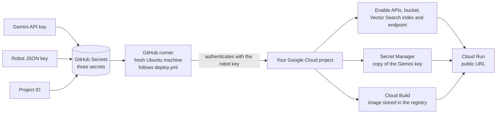
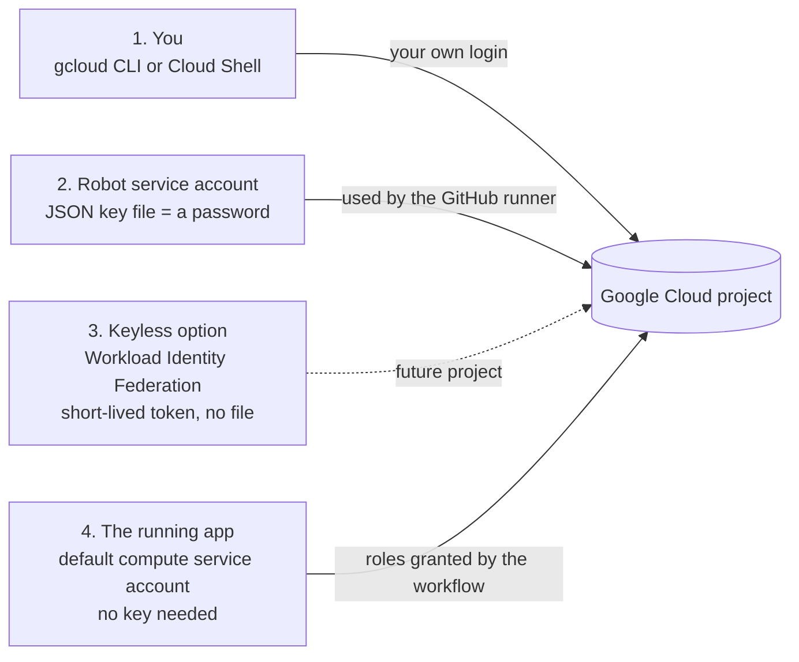
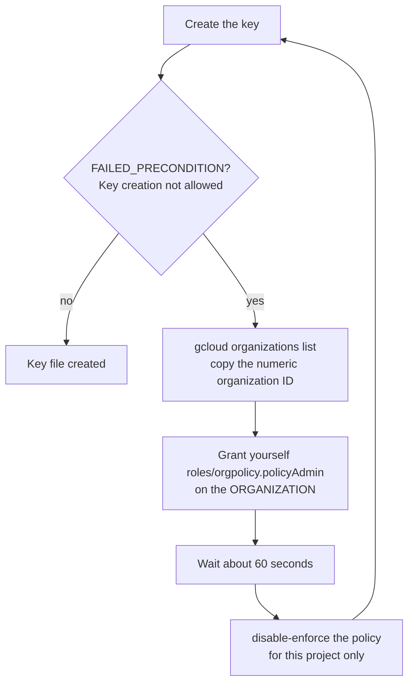
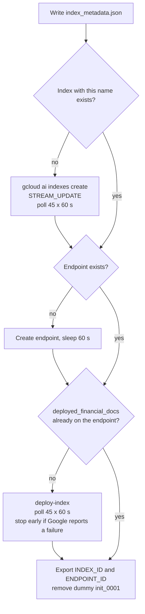
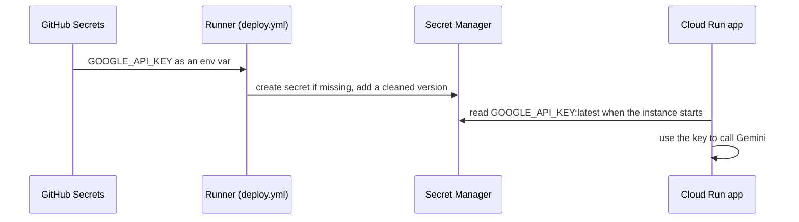
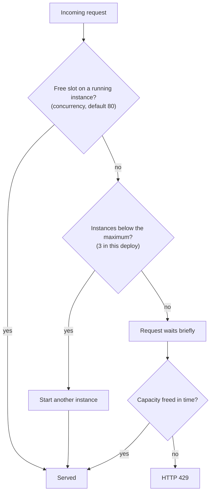

# 🚀 Meridian AI — Live Deployment: GitHub Actions to Google Cloud Run
### 📋 Agentic AI 3.0 Specialization | Krish Naik Academy

**🎙️ Mentor:** Mayank Aggarwal
**⏱️ Duration:** ~4 hours 25 minutes (recording) | **📅 Session:** Saturday, 31 October 2026
**🧩 Project:** Meridian AI, Part 2 (deployment), continued: prepare the cloud, create the robot account, store the secrets, then watch GitHub Actions build and deploy the app to Cloud Run live

---

## 📌 Session Summary

Topics covered today:

- Plan for the day and a first look at the next projects
- Money first: budget alert vs spend cap
- Gemini key, GCP project and billing: getting the cloud ready
- Six ways the cloud preparation goes wrong
- Why infrastructure as code (no hand-made services)
- The four identities in the project
- Creating the robot service account and its JSON key in Cloud Shell
- The organization-policy blocker: "Key creation is not allowed"
- The three GitHub secrets
- What starts a deployment: push, manual run, `[skip ci]`
- `deploy.yml` walkthrough: trigger, concurrency, `env`, job, ready-made actions, steps
- Enabling APIs and the "check, then create" bucket step
- Provisioning Vector Search: index, endpoint, deployment
- Secret Manager handoff, Cloud Build, runtime roles and the Cloud Run deploy
- Debugging: "it should fail on your first try"
- Reusing the pipeline for another project or team
- The app live on Cloud Run and a console tour (logs, metrics, registry, Vector Search)
- Going beyond GCP: AWS and Azure equivalents
- Cloud Run autoscaling: max and min instances, concurrency, the 60% rule
- Fast second deploy, and switching everything off
- Live Q&A (security at scale, Terraform, branch protection, careers and interviews)

---

## 📰 Quick Updates

- **Next project (preview).** An FDE-style (forward deployed engineer) system that reads supplier paperwork (invoices, packing lists, bills of lading, quality certificates, payment notes) in any format, groups the papers that belong to one shipment, and checks them against each other, the purchase order and what the warehouse received. Stack: **LangChain v1, Celery, Redis, PostgreSQL, FastAPI, a React/TypeScript front end**, deployed on **GKE Autopilot with KEDA autoscaling, Cloud SQL, Memorystore and Cloud Storage**, with sign-in and observability (LangSmith, Cloud Trace, Cloud Monitoring, Cloud Logging, Flower). Mayank will share the code once it runs locally; the repo is private. It starts **tomorrow**, and he rated it clearly harder than this one.
- **A separate, more advanced RAG project is still being built.** It covers multimodal RAG (PDFs, images, maybe audio and video), Docling extraction, chunking strategies (semantic, parent-child, proposition, late chunking), keyword, vector and hybrid retrieval, a Bedrock knowledge base, and S3 ingestion with queuing. It comes after LangGraph.
- **Timeline.** **7–8 November is off** (Diwali). The next project should wrap up around **15 or 21 November**; then **LangGraph in 2–3 classes**, a LangGraph project, and RAG taught through a project. The course now runs to roughly **February–March**, a little longer than first planned, because the material keeps growing.
- **Starting on time.** From the next class he will start on schedule even if few people have joined, out of fairness to those who arrived on time.
- **Slides.** The interactive Part 2 deck lives on a Netlify site that is expensive for him to host, so he plans to move it to his own server and add a section on his website. He promised it **within this week**. One student could not open the link on an office laptop (it worked on mobile); his guess was a company firewall rule. An async video and an MCP video are also still coming.
- **YouTube.** A video titled along the lines of "5 real-world AI projects to become a job-ready AI engineer" was due the same day, explaining why this level of project matters.
- **Doubts.** He will clear emails this week and asked everyone to re-run the project themselves during the Diwali break.

---
## References
- https://github.com/mayank953/meridian-ai-learner
- https://meridian-ai-course.netlify.app/
- https://meridian-ai-cloud-run-1007333711353.us-central1.run.app/
- https://chatgpt.com/share/6ae57e75-fa40-83ec-8962-6560b90d8e04
---

## 🧭 Where We Stand

The 25 October class ended with the robot account and a first look at `deploy.yml`. Today the pipeline actually ran: Mayank prepared the cloud, created the robot, stored three secrets in GitHub, pushed a one-character README change, and let GitHub Actions provision everything and publish the app. He started the deployment early on purpose, so the long Vector Search wait would overlap with the explanation.



---

## 💸 Money First: Budget Alert vs Spend Cap

Before touching any service, Mayank opened the billing page of his GCP console and separated two protections that are easy to confuse:

- **Budget alert.** Sends an email as spending approaches a threshold. It does not stop anything. He showed a monthly budget on his own account.
- **Spend cap.** Actually pauses the services once reached. For a running application that is dangerous: his example was a food-delivery app whose whole service would go dark when the cap hit. So in practice teams **set alerts first** and treat a cap as a deliberate decision.

The real protection against a surprise bill, he stressed, is **switching resources off** when the work is done (see the last sections). The free trial gives new customers **$300 of credit (about ₹29,000) for 90 days**, and, as the repo's `DEPLOY.md` also says, nothing is charged automatically when the trial ends unless you upgrade.

---

## 🔑 Getting the Cloud Ready: Keys, Project, Billing

The preparation checklist on the course site has five small steps, and he walked through the ones that surprise people:

1. **Gemini key from AI Studio.** He created a key, then showed that inside AI Studio the same Google account can **attach a key to a GCP project** (his project appeared in the list). The catch: Google has been changing how trial credit applies to Gemini. If the free tier does not cover your model, a pop-up may ask for a small top-up (about ₹400–500, roughly $5). Try the basic model first.
2. **Google Cloud account** on the trial or paid plan.
3. **Project and project ID.** The ID, not the name, is what every command uses. IDs are global and permanent, so they are always unique; the bucket name is built by appending to the project ID, so it is unique as well.
4. **Billing and a budget alert.**
5. **`gcloud` CLI** on your own machine (Mac, Windows or Linux), optional because Cloud Shell works too.

**Six ways this preparation goes wrong** (from the course slides):

| Symptom | What it means |
|---|---|
| Billing account not enabled | Link a billing account to the project. |
| 403 permission denied | Usually a wrong project ID. |
| Project ID already in use | IDs are global; pick another. |
| Not eligible for the free trial | You or your country already used it. |
| `gcloud` command not found | The CLI is not installed or not on your path. |
| API key not valid | The Gemini key was not created properly. |

**India-specific note.** The trial now asks for a ₹2 verification and a card, or a **₹1,000 prepayment**, a change from last year. Mayank advised deleting any automatic payment mandate created for the ₹2 check (in Google Pay or a similar app), so it cannot charge you later.

---

## 🏗️ Why Infrastructure as Code

Mayank paused to explain why the project does not have you click through the console. In a real project five, seven or ten cloud services are involved. Creating them by hand means that:

- moving from development to production repeats every click, and a different region or setting slips in;
- an API you forgot to enable stops the project at the worst moment;
- one mistake can cost the whole project its deadline.

The remedy is **infrastructure as code**: defining servers, databases, load balancers and networks in machine-readable files instead of manual setup or graphical tools. In this project the files are the `Dockerfile`, `generate_json.py` and, above all, `.github/workflows/deploy.yml`. His consistent advice for the rest of the course: **do not create things in the UI; use commands or CI/CD.**

---

## 🪪 The Four Identities

The setup involves four different "who"s, and keeping them apart makes every later step clearer:



For now the class uses the simpler **robot with a key file** so everyone can see the mechanics; **Workload Identity Federation** (WIF, where GitHub proves who it is with a short-lived token and no file exists) is slated for a later project. The app itself never holds a key: Cloud Run runs it as the default compute service account.

---

## 🤖 Creating the Robot Account in Cloud Shell

The robot is a **service account**: an account for a program, which GitHub will use to create anything it needs in the project. Mayank opened Cloud Shell, which starts already connected to his project, and copied the commands straight from the repository README ("you genuinely have to copy the command, nothing else"). The steps are, with a placeholder project ID:

```bash
export PROJECT_ID="YOUR_PROJECT_ID"
gcloud config set project $PROJECT_ID

gcloud iam service-accounts create github-deployer \
  --display-name="GitHub Actions Deployer" \
  --project=$PROJECT_ID

gcloud projects add-iam-policy-binding $PROJECT_ID \
  --member="serviceAccount:github-deployer@${PROJECT_ID}.iam.gserviceaccount.com" \
  --role="roles/editor"

gcloud projects add-iam-policy-binding $PROJECT_ID \
  --member="serviceAccount:github-deployer@${PROJECT_ID}.iam.gserviceaccount.com" \
  --role="roles/resourcemanager.projectIamAdmin"

gcloud iam service-accounts keys create github-deployer-key.json \
  --iam-account=github-deployer@${PROJECT_ID}.iam.gserviceaccount.com
```

- **Editor** lets the robot build infrastructure; **project IAM admin** lets it manage service-level permissions as well.
- These rights are deliberately broad to keep the class simple. A company would hand the robot only what it needs.
- This must be done on the command line: it cannot be done in the UI.

---

## 🚧 The Organization-Policy Blocker

On the live run the last command failed, as it does for many people:

```text
ERROR: (gcloud.iam.service-accounts.keys.create) FAILED_PRECONDITION:
Key creation is not allowed on this service account.
```

Mayank explained what happened: the project sits inside a Google Cloud **organization**, and Google blocks service-account keys by default through the organization policy `iam.disableServiceAccountKeyCreation`, because a key lets anyone who holds it control the project. Changing that policy needs the **Organization Policy Administrator** role (`roles/orgpolicy.policyAdmin`). That role **cannot be granted at the project level** (you get `INVALID_ARGUMENT`); it must be granted on the organization, even though you only relax the policy for one project.



The README's fix, with placeholders:

```bash
gcloud organizations list

gcloud organizations add-iam-policy-binding YOUR_ORGANIZATION_ID \
  --member="user:YOUR_EMAIL" \
  --role="roles/orgpolicy.policyAdmin"

# wait about 60 seconds for the role to take effect
gcloud resource-manager org-policies disable-enforce \
  iam.disableServiceAccountKeyCreation \
  --project=$PROJECT_ID

gcloud iam service-accounts keys create github-deployer-key.json \
  --iam-account=github-deployer@${PROJECT_ID}.iam.gserviceaccount.com
```

**What went wrong live, and the fixes:**

| Moment | Cause | Fix |
|---|---|---|
| "member role must be specified" | The multi-line command lost its line continuations and quotes when pasted. | He pasted it into ChatGPT to repair the quoting, then copied it line by line. |
| `gcloud` said the project was invalid or not found | Cloud Shell had reconnected (and earlier a stale project was set). | Re-export `PROJECT_ID` and run `gcloud config set project $PROJECT_ID`. |
| Key command still failing right after the grant | The role had not propagated yet. | Wait a minute, then run it again. |

The README also notes that if you are not an organization admin, someone who manages the organization must run the grant for you (or set up WIF, which needs no key). Once the key exists, the policy can be re-enabled; the key already created keeps working and only new keys are blocked. He also remarked that this approval-heavy path is normal on company clouds, and that the same pattern (robot account, key or token, secrets in CI) applies on AWS and Azure too.

---

## 🔐 Storing the Three GitHub Secrets

Mayank downloaded the key file from Cloud Shell and opened his fork: **Settings → Secrets and variables → Actions → New repository secret** (the **Secrets** tab, not Variables; secrets are the more protected store). Three entries:

| Secret | Value |
|---|---|
| `GCP_CREDENTIALS_JSON` | The entire key file, pasted exactly, with no extra lines |
| `GCP_PROJECT_ID` | The project ID |
| `GOOGLE_API_KEY` | The Gemini key from AI Studio |

His reasoning for secrets over `.env` files: once saved, values cannot be read back from the page, they never sit in the code, and workflows reference them as `${{ secrets.NAME }}`. If a secret is empty or misspelled, the **first step fails with a confusing message**, so that is the first place to look.

**Handling the key file:** never commit, email or paste it anywhere except the secret, and delete the local copy afterwards. If it leaks: revoke the key in the console, replace the secret, and, as the nuclear option, delete the project.

If the Actions tab is missing in your fork, enable workflows there first.

---

## ▶️ What Starts a Deployment

| Action | Does it deploy? |
|---|---|
| Push or commit to `main` | Yes, even a one-space edit to the README (that is how he triggered the live run) |
| **Actions → Run workflow** (`workflow_dispatch`) | Yes |
| Commit message containing `[skip ci]` | No |
| Push to another branch | No, unless you add that branch to the `on:` block (for example a `dev` branch deploying to a dev project) |
| A new Docker image created by hand in a UI | Nothing happens; the pipeline is what connects image and service |

He also noted that it makes no difference whether code changed: once the workflow starts, it executes the whole pipeline, but it skips anything that already exists.

---

## 📜 Reading `deploy.yml`

Mayank asked everyone to type "focus" in the chat, then walked the file top to bottom. His honest framing: nobody is expected to write this by hand. "Code is cheap" now, but **knowing what each block does is the skill**; he said it would take him two or three days to write such a file from scratch himself, and AI tools can generate one once you give them this as a template.

**Trigger and concurrency.** The workflow runs on pushes to `main` and manual dispatch, and allows one deployment at a time without cancelling a half-finished one:

```yaml
on:
  push:
    branches:
      - main
  workflow_dispatch:

concurrency:
  group: deploy-${{ github.ref }}
  cancel-in-progress: false
```

**`env`.** Named values reused below (project ID from the secret, region `us-central1`, service, image, bucket, index and endpoint names), like constants in code. He chose **us-central1** rather than an Indian region because many services are not available in India.

**The job.** There is one job, *Provision & Deploy*, running on `ubuntu-latest`. That is only the temporary machine GitHub provides to run the commands; it connects to Google Cloud afterwards. Bigger projects often have several jobs (for example tests first).

**Steps in order:**

1. **Checkout** (`actions/checkout`): copy the repository onto the runner so later steps can read the `Dockerfile`, `generate_json.py` and the backend.
2. **Authenticate** (`google-github-actions/auth`): sign in with `GCP_CREDENTIALS_JSON`.
3. **Set up Cloud SDK** (`setup-gcloud`): install `gcloud` and point it at the project.
4. **Enable required APIs**: a new project has every API off. Doing it in the workflow means that if a company has four or five projects, none of them needs hand-enabling. The step waits 90 seconds for propagation.
5. **Buckets, Vector Search, secrets, build, deploy** (the next sections).

**Ready-made actions** are the lines starting with `uses:`: someone has already written them, and the `@v4` or `@v2` pins the release. If a repository restricts which actions may run, these must be on the allowed list. Everything else is a plain `run:` block, which is just `gcloud` commands. As he showed by typing `gcloud` in his terminal, "GitHub is also running these commands only".

**Check, then create.** The pattern that makes re-runs safe appears in the bucket step:

```yaml
- name: Ensure Storage Buckets Exist
  run: |
    # Check and create Vector Staging Bucket
    if ! gcloud storage buckets describe ${{ env.VECTOR_BUCKET }} >/dev/null 2>&1; then
      echo "Creating vector staging bucket..."
      gcloud storage buckets create ${{ env.VECTOR_BUCKET }} --location=${{ env.REGION }} --uniform-bucket-level-access --public-access-prevention
    else
      echo "Vector bucket already exists."
    fi
```

Many pipelines just call `create`, which errors if the resource exists or produces a pile of buckets if the name changes every run. This one checks first. To demonstrate that the workflow is "nothing mysterious", he also ran `gcloud storage buckets create` by hand in Cloud Shell and showed a second bucket appear in the console.

---

## 🧠 Provisioning Vector Search

This is the longest part of the pipeline, and the one that makes the first run slow.

**Why a starter vector.** An index cannot be created empty. `generate_json.py` writes `init_embeddings.json` with one made-up 768-dimension vector (`init_0001`), and the workflow copies it into the bucket's `index-data/` folder. At the end of provisioning the dummy datapoint is removed again.

**Describing the index.** The step writes `index_metadata.json` with a `cat <<EOF` block (dimensions 768, approximate neighbour count, dot-product distance, shard size, tree-AH algorithm settings) and then creates the index only if none with that name exists. He pasted the heredoc into Cloud Shell as well (it needed a small fix) to show it simply writes a file.

```bash
gcloud ai indexes create \
  --display-name=${{ env.INDEX_NAME }} \
  --metadata-file=index_metadata.json \
  --index-update-method=STREAM_UPDATE \
  --region=${{ env.REGION }} \
  --project=${{ env.PROJECT_ID }}
```

`STREAM_UPDATE` means vectors can be added one at a time later, which is what document uploads need. A loop then polls every 60 seconds, up to 45 times, until the index appears.



**Endpoint and deployment.** The endpoint is "the address queries go to". The index is then deployed to it under the ID `deployed_financial_docs`. The loop checks every minute for 45 minutes, and each round it also asks Google whether *this* deployment has failed, so the step stops immediately with an error rather than letting the app start without a search index. The IDs are exported to `GITHUB_ENV` so the Cloud Run step can pass them to the app as settings. Mayank pointed out that this is where Chroma (the local vector store) is replaced by Vertex AI Vector Search in cloud mode.

**Timing and cost.** Google says the first deployment of an index to an endpoint typically takes **20–30 minutes** because it provisions machines for you (the repo README budgets 30–45 minutes for the whole first run). Mayank's advice: nothing is wrong when the step sits for half an hour, "go and have a coffee". This is also **the step that starts the hourly bill**. The rationale for 45 attempts is simply that the expected wait is 20–30 minutes, so the loop gives a margin.

**The live failure.** The first run failed at this stage with Google's message *"not enough resources available to fulfill the request"*. That is a capacity message from Google, not a bug in the pipeline (he suspected the trial account's checks). The fix was to commit another trivial README change to start a new run. Because every step checks before creating, the buckets were skipped, the already-created index was found, and only the deployment was retried. Re-running the workflow is always safe.

---

## 🔁 Secrets Handoff, Build and Deploy

**Gemini key: from GitHub to Secret Manager.** The key sitting in GitHub does not help the running app, which lives in GCP. So the workflow copies it into Google **Secret Manager**, which is where the app reads it from at runtime. Mayank's phrase: it moves the secret "from one secure location to another secure location". The step passes the key as an environment variable (so it never appears in the script text), strips whitespace, and adds a new secret version:

```bash
# Sanitize: strip all whitespace, newlines, carriage returns
CLEAN_KEY=$(echo -n "$RAW_GOOGLE_API_KEY" | tr -d '[:space:]')
echo "API Key length after sanitization: ${#CLEAN_KEY} characters"

# Add the sanitized value as a new secret version
echo -n "$CLEAN_KEY" | gcloud secrets versions add GOOGLE_API_KEY --data-file=-
```



**Build.** `gcloud builds submit --tag gcr.io/<project>/meridian-ai-cloud-run .` sends the repo to **Cloud Build**, which builds from the same `Dockerfile` the class used locally and pushes the image to the registry. Newer projects no longer give the build service account broad rights by default, so the workflow first grants it `roles/cloudbuild.builds.builder`, waits 60 seconds for the change to propagate, and then builds.

**Who gets which permission (all granted by the workflow, using the robot's IAM-admin power):**

| Identity | Role | Why |
|---|---|---|
| Robot (deployer) | `secretmanager.admin`, `run.admin` | Create and manage the secret; set public access |
| Default compute service account (used by build and the app) | `cloudbuild.builds.builder` | Build and push the image |
| Same | `secretmanager.secretAccessor` | Let Cloud Run read the Gemini key |
| Same | `aiplatform.user` | Vertex AI: embeddings and Vector Search |
| Same | `storage.objectAdmin` | Read and write uploads and chunk text in the bucket |

**Deploy.** The final `gcloud run deploy` passes the image, region, port 8080, a maximum of 3 instances, the settings that switch the app into cloud mode, and the secret:

```bash
gcloud run deploy ${{ env.SERVICE_NAME }} \
  --image ${{ env.IMAGE_NAME }} \
  --region ${{ env.REGION }} \
  --platform managed \
  --allow-unauthenticated \
  --port 8080 \
  --max-instances 3 \
  --set-env-vars="APP_MODE=cloud,ENVIRONMENT=production,GCP_PROJECT_ID=...,GCP_REGION=...,GCS_BUCKET_NAME=...,VERTEX_LLM_MODEL_NAME=gemini-3.8-flash,VERTEX_EMBEDDING_MODEL_NAME=text-embedding-005,VECTOR_SEARCH_INDEX_ID=...,VECTOR_SEARCH_INDEX_ENDPOINT_ID=..." \
  --update-secrets="GOOGLE_API_KEY=GOOGLE_API_KEY:latest"
```

(Shortened with `...` here; the full line is in the repo.) A last step grants `allUsers` the Cloud Run invoker role, which is what makes the URL public. Note this means **anyone with the link can call the app**, which matters for the shared-URL lesson below.

---

## 💥 "It Should Fail on Your First Try"

Mayank was blunt: if it passes the first time, kudos, but go back and understand it, because that is how he learned too. Deployment breaks for boring reasons, and failing two or three times is the learning phase. His debugging ladder, from the course page:

| Where it breaks | What to check |
|---|---|
| Nothing happens on push | Actions disabled in your fork; commit message has `[skip ci]`; wrong branch |
| Fails at authentication | Credentials secret wrong, empty or has extra lines |
| "API not used" or permission errors | The API is off or the robot lacks a role |
| Billing errors | Billing not enabled on the project |
| Build or push fails | Read the Cloud Build log; the Docker lessons apply |
| Run is green but the page shows an error | Open the **Cloud Run logs**; check the Gemini key and the index and endpoint IDs |

For anything cryptic he is relaxed about pasting the log into ChatGPT or Claude. The point is to understand the answer, not to type the commands.

**Why bother? Reuse.** Once this works, a second environment is a configuration change. For a new project (his example: *Meridian AI Prod*) or a sister team's cloud account, change the project ID and secrets and everything else repeats, with no risk of a bucket in a different region or a forgotten API. Every later code change flows through the same pipeline.

---

## 🌐 The App Is Live: A Console Tour

When the job turned green, the Cloud Run URL appeared in the Actions log and Mayank shared it with the class. Everyone could open it ("500 people able to access it, of course it is scalable"). He then toured the console:

- **Cloud Run.** The service shows live logs (including failures), request count, request latency and memory use.
- **Registry.** Images appear under `gcr.io/<project>/…`. Mayank noticed on screen that the console now shows **Artifact Registry**. Google's documentation confirms the story: Container Registry itself was shut down in March 2025, but `gcr.io` hostnames keep working because Artifact Registry serves them through `gcr.io` repositories, which is why the image path in `deploy.yml` still reads `gcr.io`. The deployed image's virtual size was **369 MB**, against the ~1.8 GB local image from the Docker class, thanks to the multi-stage build.
- **Cloud Build.** History of builds.
- **Cloud Storage.** The `…-vector-staging` bucket holds the uploaded documents; his own test upload landed there.
- **Vertex AI → Vector Search.** The index `financial-docs-production` showed a dense count of **77** vectors. Embeddings come from `text-embedding-005`; a better or OpenAI embedding model could be swapped in.
- **Cloud Logging.** All service logs with filters by resource and log name.

**The shared-URL lesson.** The app ran on his own Gemini key, so when students uploaded and asked questions through his link, his credits ran out and the app answered "resources exhausted". His takeaways: it was his mistake to share it; this is exactly **why real applications need login**; do not upload huge files; and swapping the key only moves the problem, since anyone with the link spends whoever's key is behind it. Several students (Hardik among them) owned up to having tried it, and Mayank said he would recharge the key so the app works again.

**Switching models.** The Vertex model name is currently a fixed setting. You can change it where the setting is defined (the workflow's `--set-env-vars` carries `VERTEX_LLM_MODEL_NAME`, and the app has its own default settings), or turn it into a variable that GitHub Actions passes in. He also showed that Vertex AI can be used directly through the Google GenAI client, which exposes many models, including Claude models (charged separately).

---

## ☁️ Going Beyond GCP

Because Mayank expects some students to work on AWS or Azure, he mapped each piece of this project to its equivalent. The idea carries over almost one-to-one:

| Job | GCP (this project) | AWS | Azure |
|---|---|---|---|
| Run the container, scale automatically | Cloud Run | App Runner (also Lambda, Fargate) | Azure Container Apps |
| Store the image | Artifact Registry (the old `gcr.io` name) | ECR | Container Registry |
| Build the image | Cloud Build | CodeBuild | Azure Pipelines |
| Store files | Cloud Storage | S3 | Blob storage |
| Hide the keys | Secret Manager | Secrets Manager | Key Vault |
| Read the logs | Cloud Logging | CloudWatch Logs | Azure Monitor Logs |
| Find similar text | Vertex AI Vector Search | Aurora with PGVector, or OpenSearch | Azure AI Search |
| Models | Gemini API or Vertex AI | Bedrock | Azure OpenAI in Foundry |
| Access control | IAM and service accounts | AWS IAM | Entra ID and RBAC |

His advice: know what each service is for, and if the project is your showcase, open each console page and master it. He admitted he forgets details himself because platforms rename things so often (the registry being the example).

---

## 📈 Cloud Run Autoscaling

Mayank used a slide simulator to explain why Cloud Run suits this app: it is a fully managed platform that scales out and back in by itself, with Docker making it easy to start extra copies.



The levers he named:

- **Maximum instances.** The cap on scale-out; this deploy sets 3. When it is reached, extra requests wait. In the simulator, requests that cannot be served get **HTTP 429**, "the limit that bites first".
- **Requests per instance (concurrency).** How many requests one instance handles at once. Lowering it makes you hit the ceiling sooner. He quoted 80 as the default.
- **Minimum instances.** Instances kept warm so a traffic spike starts instantly; the cost is that they bill while idle. On the "create service" screen he suggested around 2 as a sensible production minimum with a larger maximum such as 10.
- **The 60% rule.** Scaling triggers when CPU or concurrency utilization reaches 60%. With 80 slots per instance, 60% is 48 requests: his simulation held 48, and the 49th request caused a second instance to start and split the load roughly 25 and 24.
- Also available: manual scaling to a fixed count (charged accordingly) and ingress settings controlling where traffic may come from.

**Checked against Google's documentation.** The defaults line up with what Mayank said: a 60% threshold for both CPU and concurrency utilization, and a default minimum of 0 instances (so an unused service scales to zero and costs nothing). Excess requests queue for a short time (the longer of about 10 seconds or 3.5 times the average startup time) and then fail with 429, so the queue is brief rather than patient. The service's own settings in the console showed `max scale 3`, as set in the workflow; most other values were defaults. (He read out a container-concurrency value of 50 from that screen while quoting 80 as the default elsewhere, so check the number on your own service.)

---

## ⚡ A Fast Second Deploy, and Switching Everything Off

**Second run.** To prove the point about "check, then create", Mayank committed another change (without `[skip ci]`). This time the Vector Search provisioning step finished in about **4 seconds**, against roughly 30 minutes the first time, and the whole run takes about 5–7 minutes. He recalled the heaviest deployment he has worked on: a project with 4–5 GB of code and data whose complete build took **4 to 6 hours**.

**Clean up.** "Ideally, we should make sure to delete the complete project", or at least all resources, once the work is done. Otherwise they keep charging, and if someone gets into your account they can burn through your credits (or, with a public link, thousands of visitors will make Cloud Run scale and bill). His method:

1. Paste your own `deploy.yml` into ChatGPT and ask for the commands to shut down everything it created.
2. It listed the sequence: set the project; delete the Cloud Run service; **undeploy the index from the endpoint**, then delete the endpoint and then the index; delete the Cloud Storage buckets; delete the container images.
3. Alternative: **delete the whole project**. For a throwaway test project this also removes anything not in the workflow, and you can create a fresh project later, repeating the setup with a new project ID.
4. He also asked for a single Cloud Shell script with a configurable timeout, and showed it being generated (he noted that the destructive script should be read and understood before it is run). Run it from Cloud Shell or any terminal connected to your project.

**Pausing instead of deleting?** Murthy asked whether things can be turned off and restarted later. Mayank's answer: ask the AI for the CLI commands (it will give both an "off" and an "on" command, for example scaling Cloud Run to zero) and **avoid the UI**, because commands can be automated and a UI cannot. Not everything can be paused: a **bucket cannot be turned off** and still costs a little, and the repo's `DEPLOY.md` identifies Vector Search as the piece that bills by the hour while it exists, so undeploying it is what matters for cost. A paused or deleted stack of course means the public URL stops working.

**Showing it in interviews.** The live URL cannot stay up for free. Show the architecture and the GitHub repo; for an interested interviewer, redeploy before the call (about an hour of setup), or demonstrate the local version.

---

## 🗺️ What's Next

- **Tomorrow:** the next project, the supplier-paperwork reconciliation system, from the forward-deployed-engineer point of view (CI/CD only, no UI creation; Docker containers scaled on Kubernetes with `kubectl` and port forwarding).
- Mayank said the next project will repeat none of this explanation in depth: "I will not be explaining this next time"; the robot-account and secrets steps are needed on GCP, AWS and everywhere, so he took the time today.
- **Observability and latency.** Metrics such as P95 and P99 latency will be explained in the monitoring part of the next project, where they are clearer.
- **Real-world touches students asked for** (browser refresh during a long job, a custom domain via Cloud DNS, Terraform in a later project, possibly with AWS) are planned for later projects.
- Then LangGraph (2–3 classes), a LangGraph project, and RAG taught through a project. In January there is a planned system design (HLD and LLD) track, project-based, alongside coding-with-AI practice.

---

## 💬 Live Q&A Highlights

| Question | Answer |
|---|---|
| Can GitHub be forced to deploy only on a human push, not by an AI agent? (Basavanna Olekar) | Protect the `main` branch so nothing, human or AI, can commit to it directly. Require pull requests and passing status checks (GitHub or GitLab branch rules), so changes need human approval. If an agent can push to `main`, fix the repository settings first. This setup only deploys the project; it adds no AI commits. |
| How and where do secrets go? Directly to Secret Manager, or via GitHub? (Susmit Banerjee) | Here they go GitHub Secrets → workflow → Secret Manager. You could create them in Secret Manager directly, which is common when many teams share the secret; he used the GitHub route to keep one place for the class. |
| Is this the Workload Identity Federation setup? (Susmit Banerjee) | No. WIF is keyless and different; the key file used here is the simpler approach. WIF will come in a future project. |
| Does the same flow work for GKE? What about Terraform? (Susmit Banerjee) | Yes, GKE can be created the same way. Terraform provisions resources as code and does broadly what the `gcloud` steps do, but it is declarative infrastructure, not a CI/CD tool; GitHub Actions or Jenkins run the pipeline. He has not used Terraform himself in this role. |
| Can we use Terraform to deploy on GCP? (Siddiq) | He will use it in one future project, perhaps with AWS. The concepts are the same; it is just commands. |
| What do I tell ChatGPT to create the YAML, and how will it know my variables? (Anurag) | Give it a template (this file). Whatever changes per environment or is sensitive (project ID, Gemini key, credentials) becomes a secret you reference, never written into the YAML. Ask it to put names such as bucket, index and image in single variables at the top. Learning by doing two or three projects is the real answer; expect some days of trouble at first. |
| Are the resources created at every deploy? (in-flow) | No. The first run provisions them; later runs skip what exists and are quick. |
| Does a push with no code change still run the full pipeline? (in-flow) | Yes, once it starts it executes the whole pipeline, skipping existing resources. |
| Why did the MFA screen block project creation? (Vasudev N) | Mayank could not reproduce it and said MFA can be skipped for now. Vasudev later fixed it himself with an OTP-based setup. |
| Is there something like Azure resource groups in GCP, to see what a project costs? (Harshit Goyal) | Not exactly: GCP works by enabling APIs per project, and the project itself is the logical container. He was not sure about a newer equivalent and asked Harshit to check. |
| How do I delete everything after use? (rahul) | Delete resources one by one (Cloud Run, buckets, images, secrets), or delete the whole project, the quickest way. Ask an AI for the commands for your own workflow. |
| Will doing this project help in interviews? (Harish B R) | Yes, if you do it properly and understand it rather than copy it. Add it to your CV, learn LangChain in depth (other frameworks follow similar ideas); several people from the batch have cleared interviews. |
| Where can I get PDFs of the ML and deep learning videos? (Harish B R) | He does not have them (they are the YouTube series by another instructor); he will ask whether they can be shared. |
| Why run the check 45 times? (in-flow) | Google takes 20–30 minutes, so polling every minute for 45 minutes gives margin. |
| Where do I run the delete script? (in-flow) | In Cloud Shell, or any terminal connected to your project. |
| Do we need to upload PAN card or verify identity for the trial? (Akanksha Verma) | He created a fresh account two weeks ago to see what students would hit: it asks for a ₹2 check on a card, or a ₹1,000 prepayment, and he said she could carry on without the extra 90-day verification step. Delete any auto-pay mandate created for the ₹2 check. |
| Next time can we use the Docker container option in Cloud Run instead of the repo option? (Akanksha Verma) | The next project uses containers on Kubernetes and is deployed only through CI/CD; nothing will be created through the UI. |
| How should IAM be handled at large scale, for example an agentic SAP project on AWS across 150+ countries? (Anil) | Layers: lock down ingress so only the intended API is reachable, put the app on the company VPN or private network, add login and 2FA/MFA, and keep logs. He called this about 60–70% of the work; the rest should be designed with the security and infosec team, who approve it at the architecture review. Not his own expert area. |
| Should the URL use a custom domain with Cloud DNS? (Vasudev N) | Easy to do (just DNS entries); ingress matters more. Possibly in a later project. |
| Are the resources billed to the free trial? (Vasudev N) | Yes. Unless you upgrade the account you will not be charged; resources are only marked for deletion after the trial. Still delete the project to avoid wasting credit. If Gemini says "resources exhausted", the key needs credit. |
| What depth does a leader with 20+ years in data analytics need? (Venkat) | Architect-level system design and ownership: be able to decide how the system handles thousands of users, why Redis and Celery are used, which embedding model, and so on. A role like Technical Product Owner owns several such products. You would not code or deploy; he said he does perhaps 20–30% of that job himself. |
| I come from a testing background; the stack is new. What role should I pitch? (Hardik Vora) | Focus on skills, not titles: this project makes you ready for AI engineer, LLM engineer and LLM evaluation roles. Industry is in a 2–3 year transition and people with end-to-end AI project depth are rare. Interviews for senior profiles lean on system design. |
| What do interviews actually ask? DSA, LLD, HLD? (Hardik Vora, rasmibala sahoo) | Large companies keep DSA rounds (Google especially), plus LLD, machine coding and HLD; read interview experiences company by company. DSA helps you read and judge AI-written code, but it should not come before the AI projects. He shared his own Uber story: he prepared for a machine-coding round, got an unexpected trie question, knew the approach but could not get working code in C++, and Uber wanted code that runs. He plans AI system design content and will share recordings free for the batch. |
| Model-building or application roles? (Hardik Vora) | More openings are on the using side (applications). Building models needs research experience and a long runway. Fine-tuning is also less common because capable models arrive quickly. |
| What types of agents are there? (rasmibala sahoo, asked in a recent interview) | The standard taxonomy: simple reflex agents, model-based reflex agents, goal-based and utility-based agents; also know ReAct and multi-agent and hierarchical patterns. Read about them once; they are theory questions. |
| Will the January HLD/LLD course be project-based? (Harshit Goyal) | Yes, projects. He will first teach coding with AI tools, then show how projects run end to end from his client experience, and plans to share it free for the batch. |
| What happens if the user refreshes the browser during a 10–15 minute job, or a 100 MB upload? (Harshit Goyal) | Keep job state on the backend, tied to a run or session ID, and have the front end reattach after refresh. Meridian does not handle this yet but he will include it in the next two projects. An upload cut midway generally has to restart unless it is resumable. |
| Gemini Pro credit for AI Studio? (Harshit Goyal) | A student pointed out that a Gemini Pro subscription gives monthly developer credit (the link was pasted in chat); Mayank said he would look into it. |
| What if Google changes its console UI or renames services and production breaks? (Basavanna Olekar) | The UI is not a dependency of the app; only the backend APIs matter. Google gives deprecation warnings in logs and emails before decommissioning. The rename from Container Registry to Artifact Registry is an example. |
| Do ACID-style guarantees apply to vector databases? (Basavanna Olekar, adding to an earlier classmate's question) | He suggested logging and transactions behave as with other databases: failures during a network issue are usually rolled back or marked as unindexed in metadata so you can restart from the failure point. Mayank agreed it is also a database. |
| Practising feels much harder than watching. Any best way? (Murthy) | No shortcut: it takes 3–4 hours for a learner where he takes one. Follow the commands step by step, read the Learner Guide pages (like doc 13), and after two or three projects it becomes natural. |
| Why does the course link fail on my office laptop? (Murthy) | Company networks can block sites; it worked on mobile. He will host the slides himself. |
| Does the local Docker setup depend on the GCP deployment? Does the app still use Chroma? (Murthy) | No. Local needs no GCP and cloud needs Docker. One environment setting decides which store is used: local mode uses Chroma and local folders; cloud mode uses Vertex Vector Search and Cloud Storage. Only one path runs at a time. |
| How do we tune latency? (Murthy) | There is no single setting: find where the delay is (front end, app, vector DB) and fix that. Often it is code, sometimes configuration. Monitoring shows P50, P95 and P99. Hard to reproduce at class scale. |
| How should I explain the architecture in an interview? (Murthy) | Use the README architecture diagram: client layer, API gateway, GCP AI services, CI/CD. Be ready for specifics, for example for autoscaling: Cloud Run, three instances maximum, scaling at about 80 requests per instance, not just "GCP autoscaling". |
| Which job sites other than Naukri and LinkedIn? (Murthy) | InstaHire was useful for him and friends in 2023–24. Also post your learning on GitHub and LinkedIn and tag him; content travels and recruiters find it. |
| Why GitHub secrets rather than GCP Secret Manager, and what is real practice? (Venki) | Real teams do this too; the secrets are stored encrypted and cannot be read back. The workflow also copies the Gemini key to Secret Manager so the app can use it. |
| Why Cloud Run rather than GKE? (Venki) | Cloud Run is managed and scales on its own, simpler for an app like this. GKE (with its autoscaling pods) needs `kubectl` knowledge and is for more advanced apps, as in the next project. |
| Why use Cloud Build rather than building in the workflow? (Venki) | Both work; he had not done it the other way. Running `docker build` on the runner and pushing the image is possible. Here, `gcloud builds submit` builds in Google's service and pushes straight to the registry. |
| Is a normal bucket where embeddings are stored? How is it different from vector storage? (Venki) | No. The bucket stores files (documents, logs). Embeddings go to the vector store, because you cannot do semantic search on files in a bucket. |
| Does the Gemini key stay tied to AI Studio? (Venki) | No. Once pasted into the secret, the app only needs the key; you track usage and limits in AI Studio. You can swap in OpenAI or Claude later if the code changes too. |
| What are P95 and P99? (Venki) | Latency percentiles. He will explain them with the monitoring part of the next project. |
| How do I catch up after a long absence? (Rama Subramanyam) | Start from the 3–4 October weekend where the Meridian project began, using the shared link and the repo (organized by weekend). Email him and he will reply this week; AI tools can explain the code. |

---

## 🔑 Key Pointers to Remember

- **Budget alerts warn; spend caps stop.** Stopping a live app is rarely what you want, so alert first. Switching resources off is what really stops the bill.
- **Infrastructure as code beats clicking.** A workflow file repeats exactly: same region, same APIs, same names, for dev, prod or another team.
- **Four identities:** you, the robot with a key, the keyless WIF option, and the app's own service account.
- **The robot's JSON key is a password.** Only in a GitHub secret, never in the repo. Leaked: revoke the key, replace the secret, or delete the project.
- **"Key creation is not allowed"** is an organization policy. Grant `orgpolicy.policyAdmin` on the organization, not the project, then disable the constraint for the project.
- **Three secrets only:** `GCP_CREDENTIALS_JSON`, `GCP_PROJECT_ID`, `GOOGLE_API_KEY`; in the Secrets tab.
- **A push to `main` deploys**, even a one-space edit; `[skip ci]` skips it; other branches need to be added.
- **The runner is a throwaway Ubuntu machine** that follows the YAML and runs plain `gcloud` commands.
- **Check, then create** makes every re-run safe. That is why retrying after a failure is fine.
- **Vector Search index cannot start empty**, hence the dummy `init_0001` vector; the first deployment takes 20–30 minutes and starts the hourly bill.
- **GitHub secret to Secret Manager:** the app reads the key from GCP, not from GitHub.
- **It should fail the first time.** Walk the debugging ladder: credentials, API or permission, billing, build, then Cloud Run logs.
- **A public URL spends someone's key.** Shared links burned through Mayank's Gemini credit; real apps need login.
- **Cloud Run scales to its limit:** default concurrency, 60% utilization trigger, maximum instances; beyond capacity, requests wait briefly and then get 429.
- **Cloud equivalents are one-to-one:** know the service names on all three clouds.
- **Branch protection is a repo setting**, not part of the pipeline, but it is what keeps AI and humans off `main`.
- **Delete or undeploy when done**, preferably with commands, never the UI.

---

## ✅ Action Items After This Session

- [ ] Pull the latest `meridian-ai-learner` repo; re-read the README's "Deploying to a Brand New GCP Project" and `DEPLOY.md`.
- [ ] Make sure you have a GCP account with billing and a **budget alert**; note your **project ID**.
- [ ] Create a Gemini API key in AI Studio (add small credit if the free tier blocks your model).
- [ ] In Cloud Shell: create the `github-deployer` service account, grant the two roles, and create the key. If it fails with "Key creation is not allowed", follow the organization-policy fix.
- [ ] Add the three **secrets** (not variables) to your fork; confirm the Actions tab is enabled.
- [ ] Trigger the workflow with a README commit; watch each step and note which ones are "check, then create".
- [ ] Deliberately read the Actions log when something fails, then use the debugging ladder.
- [ ] Open Cloud Run, Artifact Registry, Cloud Storage, Vertex AI → Vector Search, Secret Manager and Logging in your own project.
- [ ] Try changing the Gemini model name (in the workflow's `--set-env-vars` or the settings) and redeploy.
- [ ] **Switch everything off** when done: undeploy and delete the index and endpoint, delete the service and buckets, or delete the project. Read any generated cleanup script before running it.
- [ ] Optional: make a `dev` branch trigger a separate deployment, and set branch protection on `main` in your fork.
- [ ] Revise the Docker and deployment material before the next project starts tomorrow.

---

*📝 Notes compiled from the full 31 October 2026 session transcript, the `mayank953/meridian-ai-learner` repository (`.github/workflows/deploy.yml`, `README.md` and `DEPLOY.md`), and Google's documentation on Cloud Run autoscaling and the Container Registry to Artifact Registry transition — "Meridian AI — Live Deployment: GitHub Actions to Google Cloud Run," Agentic AI 3.0 Specialization, Krish Naik Academy. The course site (`meridian-ai-course.netlify.app`) could not be retrieved while preparing these notes.*
